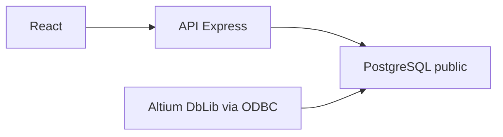

# Plan — TP final

El plan de esta conversación, textual.

Gestor de componentes (React + TypeScript + PostgreSQL, capas router → controller → service → repository → entity) cuya base la consume Altium por ODBC. Una tabla por hoja de cdb.xls, con los nombres de columna del Excel y una columna Part Number única como clave.

Tareas:

1. Esquema PostgreSQL (17 tablas, Part Number, trigger en schema app), seed desde cdb.xls y docker-compose. PR contra main.
2. API Express + TypeScript en router → controller → service → repository → entity, CRUD genérico por catálogo. PR anidado.
3. Interfaz React para listar, crear, editar y borrar componentes según el tipo. PR anidado. Verificar el flujo en el browser.

# Gestor de componentes para Altium

## Qué pide Altium de la base

Altium no se conecta a PostgreSQL con un driver propio. Un archivo `.DbLib` (se crea en Altium, en Windows) usa ADO/OLE DB contra un DSN ODBC de 64 bits (psqlODBC). Cada tabla habilitada aparece como una biblioteca en el panel Components.

Para colocar un componente hacen falta, en el mapeo del DbLib, estos datos (documentación de Altium, [Creating & Defining the Database Library](https://www.altium.com/documentation/altium-designer/components-libraries/database-libraries/creating-defining)):

- Una clave única por tabla. Después de colocar la pieza, Altium reencuentra la fila con esa clave. Va a ser la columna nueva `Part Number`.
- `Library Ref`: nombre del símbolo en el `.SchLib`. Sin esto no se puede colocar. En las 302 filas del Excel ya está cargado.
- Al menos un `Footprint Ref`: huella por defecto. También está cargado en las 302 filas.
- `Library Path`, `Footprint Path` y los pares 2 y 3 son opcionales si el DbLib tiene search paths. El Excel ya los trae; se conservan.
- `Description` se mapea solo a `[Description]` porque el nombre coincide con el reservado de Altium.
- El resto de columnas (Value, Voltage, Package, etc.) no las exige la conexión: Altium las copia como parámetros del componente.

En el DbLib, por tabla: Single key lookup sobre `Part Number`. En Advanced, las comillas de PostgreSQL son `"` y `"`, no los corchetes de Access. Con eso los nombres con espacio (`Library Ref`, `Manufacturer PN`) funcionan. Include Table Schema Names queda apagado.

No se agregan columnas de aplicación (`id`, fechas). Altium convierte cada columna en parámetro o en enlace de modelo.

`Comment` no está en el Excel y no hace falta para conectar. Sin esa columna, el comentario del esquemático queda el del símbolo. Queda fuera de este plan.

Los `.SchLib` y `.PcbLib` no vienen en el Excel. La base guarda el nombre y el path; los archivos tienen que existir donde Altium los busque.

## Datos del Excel

[cdb.xls](/mnt/c/Users/jbmil/OneDrive/Desktop/cdb.xls): 17 hojas y 302 filas. Cada hoja es una tabla. La hoja `MISC` repite el encabezado `Description` en una columna vacía; esa columna no se crea (PostgreSQL no admite dos columnas con el mismo nombre).

`Manufacturer PN` se deja igual que en el Excel. No sirve como clave: `SM712-02HTG` está dos veces en `TVS` (símbolo distinto) y `Generic_0805` / `Generic_1206` están dos veces en `RESISTOR` (huella comercial y huella MIL). `MISC` no tiene ese campo; identifica con `Key`.

Regla de `Part Number`, única en toda la base:

- Si hay `Manufacturer PN` y no se repite en el libro, `Part Number` es ese valor.
- En `MISC`, `Part Number` es `Key`.
- Si se repite: se le suma `Library Ref`. Si sigue repetido, también `Footprint Ref`.
  - `SM712-02HTG | SM712` y `SM712-02HTG | TVS bidirectional 2 channel`
  - `Generic_0805 | Res1 | R0805_M` y `Generic_0805 | Res1 | MIL-PRF-55342/6_RM0705_M` (y lo mismo para 1206)

Todas las columnas son texto. Celda vacía se guarda como NULL.

## Forma de la base

Tablas en `public`, nombre igual a la hoja (`CAPACITOR`, `INDUCTOR`, `FERRITE`, `RELAY`, `SWITCH`, `DIODE`, `TVS`, `LED`, `OPTO`, `BJT`, `MOSFET`, `IC`, `MISC`, `RESISTOR`, `SSR`, `XTAL`, `FUSE`), columnas entre comillas para conservar mayúsculas y espacios. `Part Number` es la primera columna y la clave primaria.

Para que la misma clave no exista en dos tablas (Altium busca la clave en todas las tablas habilitadas), un registro en el schema `app` (Altium no lo lista si Include Table Schema Names está apagado) y un trigger que rechace un `Part Number` repetido.

## Aplicación

Backend Node + Express + TypeScript. El router es de Express; React no entra en esa cadena. Lectura de lo que pediste: React en el frente, y en el servidor router, controller, service, repository, entity.

Una sola entidad de componente, no 17 copias. El tipo es el nombre de la tabla; los campos salen de un catálogo generado desde el Excel. Nombres de tabla y de columna solo se aceptan si están en ese catálogo. Los valores van parametrizados.

- `GET /api/component-types`
- `GET/POST /api/components/:type`
- `GET/PUT/DELETE /api/components/:type/:partNumber`

El service exige `Part Number`, `Library Ref` y `Footprint Ref`. El resto es opcional.

El frente lista los tipos, muestra la tabla y abre un formulario armado con el catálogo para crear y editar. Textos de la interfaz en español. Los nombres de columna quedan como en Altium.

## Archivos

Todo bajo [tp-final/](tp-final/). El informe [tp-final/README.md](tp-final/README.md) suma cómo levantar Postgres, la API y el frente, y los pasos del DbLib (DSN, comillas `"`, clave `Part Number`, tablas a habilitar).

- `docker-compose.yml`, `db/001_tables.sql`, `db/002_seed.sql`
- copia del Excel y catálogo en `data/`
- `backend/src/` con `router`, `controller`, `service`, `repository`, `entity`
- `frontend/` con Vite + React + TypeScript

## Pull requests anidados

1. Esquema, seed y compose, contra `main`. Incluye la sección de Altium en el informe.
2. API, contra la rama del PR 1.
3. Interfaz, contra la rama del PR 2.

## Fuera de este plan

- El archivo `.DbLib` (se arma en Altium con lo escrito en el informe).
- Librerías de símbolo y huella.
- Columna `Comment`, simulación, proveedores y login.
